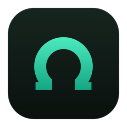
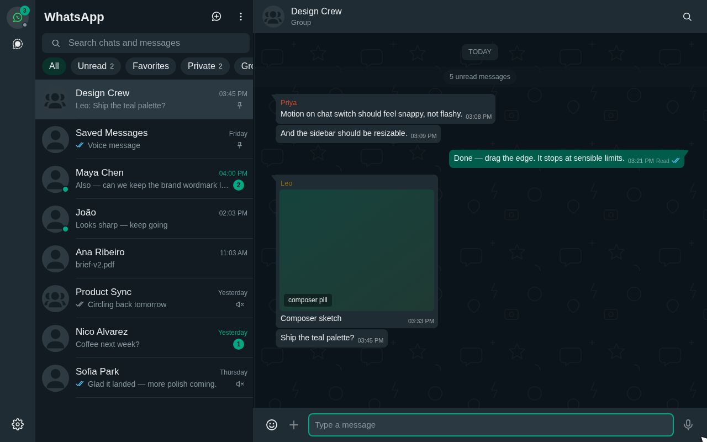
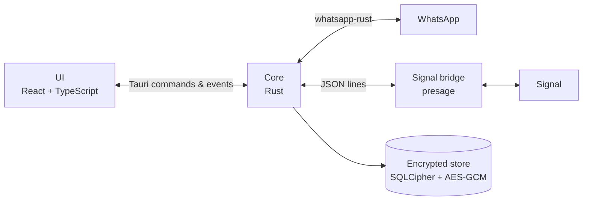

<div align="center">



# Omega Zap

### WhatsApp and Signal in one native desktop app.

**Linked to your phone. No browser shell. Everything kept on your computer, encrypted.**

[](https://github.com/joaomdsferro/omega-zap/releases)
[](https://github.com/joaomdsferro/omega-zap/actions/workflows/release.yml)
[](#install)
[](https://v2.tauri.app)
[](LICENSE)

[Install](#install) · [Features](#features) · [How it works](#how-it-works) · [Privacy](#privacy) · [FAQ](#faq) · [Contributing](CONTRIBUTING.md)

<br />



</div>

---

> [!WARNING]
> **Early test version (v0.0.x).** Expect bugs, missing features, and changes that may ask you to link
> your accounts again. Omega Zap is an unofficial client, not affiliated with WhatsApp, Meta or Signal.
> It is built for everyday chatting, not bots or bulk messaging; see the [FAQ](#faq).

Omega Zap is a desktop client for WhatsApp and Signal, part of the open-source
[Omega](#about-omega) family. It links to your phone like WhatsApp Web or Signal Desktop do, but runs
natively: the UI is a small Tauri window and both protocols run in Rust. Close the window and it keeps
running in the tray, using a fraction of the memory.

## Install

Download the package for your distribution from the
[latest release](https://github.com/joaomdsferro/omega-zap/releases):

| Distribution | Package | Install |
| --- | --- | --- |
| Debian, Ubuntu, Mint, Pop!_OS | `.deb` | `sudo apt install ./Omega*Zap_*_amd64.deb` |
| Fedora, openSUSE | `.rpm` | `sudo dnf install ./Omega*Zap-*.x86_64.rpm` |
| Any other (Arch, CachyOS…) | `.AppImage` | `chmod +x Omega*Zap_*.AppImage` and run it |

Then **link your accounts**: open Omega Zap and scan the QR code from your phone, under
**Linked devices → Link a device** in WhatsApp, or **Settings → Linked devices** in Signal. On Signal,
choose **Transfer message history** to bring your existing chats.

Windows and macOS builds are not available yet.

## Features

| | WhatsApp | Signal |
| --- | :---: | :---: |
| Text with formatting, emoji and mentions | ✅ | ✅ |
| Replies, reactions, forwarding, starred messages | ✅ | ✅ |
| Photos, videos, GIFs, voice messages, stickers, documents | ✅ | ✅ |
| Sending files (drop, paste or pick) | ✅ | ✅ |
| Link cards, sent and received | ✅ | ✅ |
| Read receipts and delivery ticks | ✅ | ✅ |
| Desktop notifications, tray with unread badge | ✅ | ✅ |
| Search across every chat, and inside one | ✅ | ✅ |
| Full history, fetched from the phone in the background | ✅ | at linking |
| Favorites and chat lists, in sync with the phone | ✅ | on this computer |
| Archive, pin, and mute for 8 hours, a week or always | ✅ | on this computer |
| Typing, online and last seen, with privacy settings | ✅ | ❌ |
| Editing your texts, and seeing others' edits | ✅ | ✅ |
| Polls (voting), locations and contact cards | ✅ | ❌ |
| Clear and delete chats | ✅ | on this computer |
| Block, exit groups, edit groups and manage members | ✅ | ❌ |
| Recording voice messages | ❌ | ❌ |

Both accounts can be used side by side or merged into one chat list. The interface looks like
WhatsApp Web by default and also comes in Omega Zap's own themes. See [all features](docs/features.md).

## How it works



The UI talks to the core through one backend interface. WhatsApp runs inside the core; Signal runs
in a separate bridge process, since its library is AGPL and links a different SQLite. See
[architecture](docs/architecture.md).

## Privacy

- Messages, media and keys stay on your computer. Nothing goes to a server of ours, because there
  is none.
- Everything stored is encrypted: chat history and sessions in SQLCipher, files with AES-256-GCM.
  The key lives in your desktop keyring (KWallet, GNOME Keyring).
- To make a card for a link that came without one, the app opens the page itself, from public
  addresses only. **Settings → Links** turns that off.

## Build from source

Requirements: Rust (stable, 1.94+), Node.js 22+, [pnpm](https://pnpm.io), and the
[Tauri prerequisites](https://v2.tauri.app/start/prerequisites/) for Linux.

```sh
pnpm install
pnpm tauri dev     # run in development
pnpm tauri build   # .deb, .rpm and AppImage in src-tauri/target/release/bundle
```

The first build also compiles the Signal bridge, which takes a few minutes.

## FAQ

<details>
<summary><strong>Can my account be banned for using it?</strong></summary>

It is unlikely with normal use, but we cannot promise it never happens. Omega Zap is unofficial, and
WhatsApp's terms do not allow unofficial clients.

What WhatsApp and Signal act on is abuse: spam, bulk messaging, bots and scams. Omega Zap is built for
the opposite. It links to your phone as one more device, as WhatsApp Web and Signal Desktop do, and
shows your chats as they would. It has no bulk sending or automation, and forwarding stops at five
chats, as it does in WhatsApp. Use it as you would use WhatsApp Desktop and you look like any other
person chatting.

The difference is that your messages are stored on your computer, the app is faster and lighter, and
WhatsApp and Signal live in one window.
</details>

<details>
<summary><strong>Does my phone need to stay online?</strong></summary>

No. Like WhatsApp Web and Signal Desktop, Omega Zap is a linked device and works on its own once
linked. Fetching older WhatsApp history in the background needs the phone to answer.
</details>

<details>
<summary><strong>How do I remove it?</strong></summary>

Log out of each account in **Settings → Accounts**, then uninstall the package. Your data lives in
`~/.local/share/rocks.omegazap.desktop/`; delete that folder to remove everything. On Signal, also
remove "Omega Zap" from the phone's linked devices.
</details>

<details>
<summary><strong>I found a bug. What should I do?</strong></summary>

[Open an issue](https://github.com/joaomdsferro/omega-zap/issues/new/choose) with what you did, what
happened and your distribution. Never paste message contents, phone numbers or QR codes.
</details>

## Documentation

- [Features](docs/features.md): everything the app does, in detail
- [Architecture](docs/architecture.md): how the code is laid out and where data lives
- [Contributing](CONTRIBUTING.md): setting up, conventions and pull requests
- [Security](SECURITY.md): reporting a vulnerability

## About Omega

Omega is a family of open-source apps by the Wisething team and anyone
who wants to contribute. Each app is small, native and private by default. Omega Zap is the first.

## Disclaimer

Omega Zap is not affiliated with, endorsed by or connected to WhatsApp, Meta or Signal. Their names
and marks belong to their owners.

## License

[MIT](LICENSE), except [`signal-sidecar/`](signal-sidecar): it links `presage` and `libsignal`, which are
AGPL-3.0, so the `omega-zap-signal` binary is AGPL-3.0-only and its source is offered under that license.
